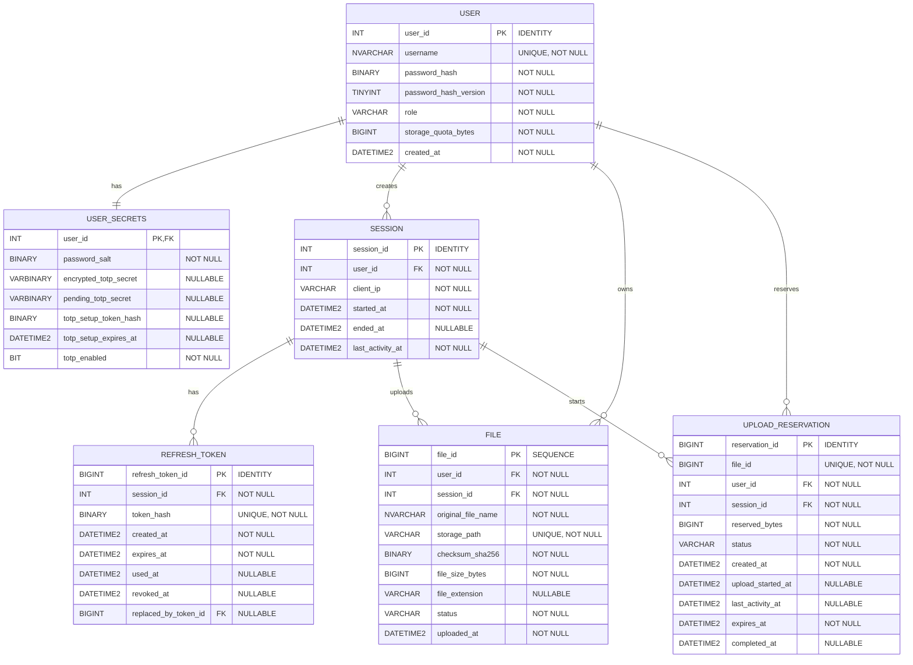
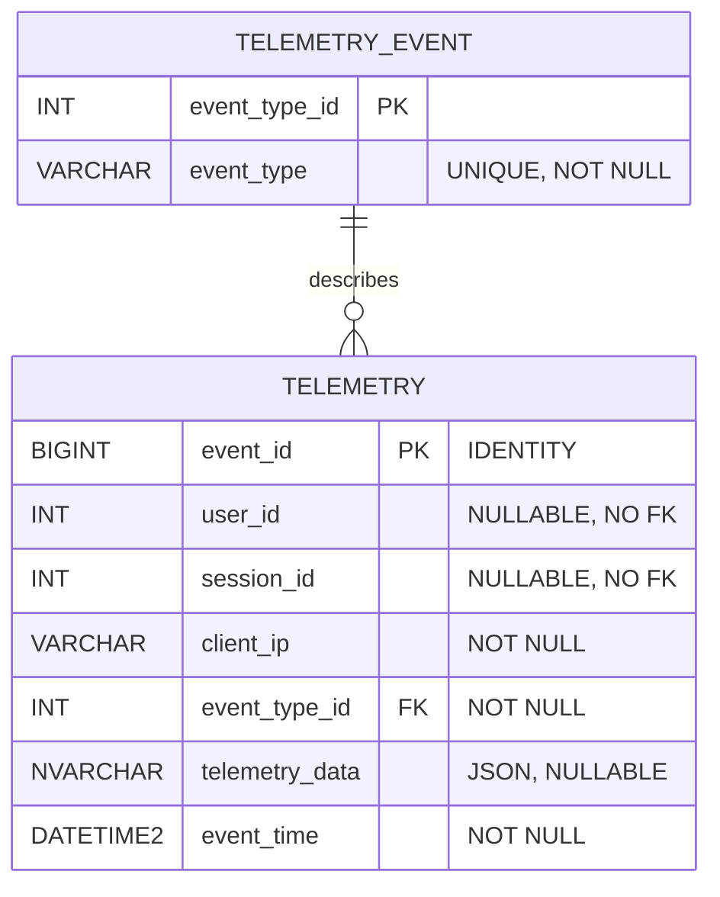

# Database Design

## 1. Database Overview

The application uses two SQL Server databases.

- **Core Database:** stores users, user secrets, sessions, refresh tokens, files, and upload reservations.
- **Telemetry Database:** stores application events. It can store events from unknown or unauthenticated users.

The application stores file content on the file system. The Core Database stores file metadata and the relative storage path.

All date and time values are stored in UTC. Use `DATETIME2(3)` for date and time columns.

The API Server is the only application component that accesses these databases and the file system. The TUI must not access them directly.

## 2. Entity-Relationship Diagrams

### 2.1 Core Database



Each file has one owner and one upload session. The database must check that the upload session belongs to the file owner.

Each session can have many refresh token records. Old token records stay in the database so the application can detect token reuse.

An upload reservation holds quota while an upload is pending or active. A completed reservation stays for 24 hours so a retry can return the result of the first upload.

### 2.2 Telemetry Database



`user_id` and `session_id` in this database are logical links to the Core Database. They do not have foreign keys. This lets the application record events when a user or session is unknown.

## 3. Data Dictionary

The tables below use the listed SQL Server names and data types.

### 3.1 Core Database

#### USER (`dbo.Users`)

| Column | SQL Server type | Null | Rules |
|---|---|---:|---|
| `user_id` | `INT IDENTITY(1,1)` | No | Primary key. SQL Server creates the value. |
| `username` | `NVARCHAR(100)` | No | Must be unique. |
| `password_hash` | `BINARY(32)` | No | Stores the Argon2id output. |
| `password_hash_version` | `TINYINT` | No | Version `1` uses the settings in Section 7.1. |
| `role` | `VARCHAR(20)` | No | Allowed values are `user` and `admin`. Default is `user`. |
| `storage_quota_bytes` | `BIGINT` | No | User storage limit. Default is 10 GB (`10000000000` bytes). |
| `created_at` | `DATETIME2(3)` | No | Account creation time in UTC. Default is `SYSUTCDATETIME()`. |

Only an admin can create users or change their quota. There is no public registration endpoint.

#### USER_SECRETS (`dbo.UserSecrets`)

| Column | SQL Server type | Null | Rules |
|---|---|---:|---|
| `user_id` | `INT` | No | Primary key and foreign key to `Users.user_id`. |
| `password_salt` | `BINARY(16)` | No | A random 16-byte salt for the user's password. |
| `encrypted_totp_secret` | `VARBINARY(512)` | Yes | Encrypted confirmed TOTP secret. `NULL` until setup is confirmed. |
| `pending_totp_secret` | `VARBINARY(512)` | Yes | Encrypted TOTP secret during enrollment. Clear it after confirmation or expiry. |
| `totp_setup_token_hash` | `BINARY(32)` | Yes | SHA-256 hash of the temporary setup token. Never store the raw token. |
| `totp_setup_expires_at` | `DATETIME2(3)` | Yes | Expiry time of the temporary setup token in UTC. |
| `totp_enabled` | `BIT` | No | Default is `0`. Set to `1` only after the first valid TOTP code is confirmed. |

A new user cannot log in until TOTP setup is complete. The application must not treat a pending secret as an active TOTP secret.

When setup succeeds, the application moves the pending secret to `encrypted_totp_secret`, clears the pending secret and setup-token fields, and sets `totp_enabled` to `1`.

The TOTP encryption key must stay outside the database. The application must protect the setup token and must never log it.

#### SESSION (`dbo.Sessions`)

| Column | SQL Server type | Null | Rules |
|---|---|---:|---|
| `session_id` | `INT IDENTITY(1,1)` | No | Primary key. SQL Server creates the value. |
| `user_id` | `INT` | No | Foreign key to `Users.user_id`. |
| `client_ip` | `VARCHAR(45)` | No | Client IPv4 or IPv6 address. |
| `started_at` | `DATETIME2(3)` | No | Session start time in UTC. Default is `SYSUTCDATETIME()`. |
| `ended_at` | `DATETIME2(3)` | Yes | Session end time in UTC. `NULL` means it has not been ended. |
| `last_activity_at` | `DATETIME2(3)` | No | Time of the last user action or heartbeat in UTC. |

A session is active only when both conditions are true:

- `ended_at IS NULL`.
- `last_activity_at` is less than 20 minutes old.

The API must check these conditions on every authenticated request. The cleanup task checks sessions every minute, ends inactive sessions, and revokes their active refresh tokens.

Authenticated user actions update `last_activity_at`. Refresh requests and background monitoring requests do not update it. The TUI sends a heartbeat at most once per minute while the user is active.

The admin API lists active sessions only. It returns `session_id`, `user_id`, username, `client_ip`, `started_at`, and `last_activity_at`. A session that passed the inactivity limit must not appear as active, even if the cleanup task has not ended it yet.

#### REFRESH_TOKEN (`dbo.RefreshTokens`)

| Column | SQL Server type | Null | Rules |
|---|---|---:|---|
| `refresh_token_id` | `BIGINT IDENTITY(1,1)` | No | Primary key. SQL Server creates the value. |
| `session_id` | `INT` | No | Foreign key to `Sessions.session_id`. |
| `token_hash` | `BINARY(32)` | No | SHA-256 hash of the refresh token. Must be unique. |
| `created_at` | `DATETIME2(3)` | No | Token creation time in UTC. |
| `expires_at` | `DATETIME2(3)` | No | Token expiry time in UTC. |
| `used_at` | `DATETIME2(3)` | Yes | Time when the token was used for refresh. |
| `revoked_at` | `DATETIME2(3)` | Yes | Time when the token was revoked. |
| `replaced_by_token_id` | `BIGINT` | Yes | ID of the new token that replaced this token. It must belong to the same session. |

The application stores only the token hash. The raw refresh token stays in the client's OS keyring.

The refresh token has a maximum lifetime of 30 days. The application rotates it every time it is used. Old rows stay in the database to detect token reuse.

If a used token is sent again, the application ends the related session and revokes all active refresh tokens for that session.

#### FILE (`dbo.Files`)

| Column | SQL Server type | Null | Rules |
|---|---|---:|---|
| `file_id` | `BIGINT` | No | Primary key. The application gets the value from `dbo.FileIdSequence`. |
| `user_id` | `INT` | No | Foreign key to `Users.user_id`. This is the file owner. |
| `session_id` | `INT` | No | Upload session. It must belong to the same user as `user_id`. |
| `original_file_name` | `NVARCHAR(255)` | No | Safe name for display. It is not the physical file name. |
| `storage_path` | `VARCHAR(512)` | No | Unique path relative to the storage root. Use `/` as the path separator. |
| `checksum_sha256` | `BINARY(32)` | No | SHA-256 checksum of the file content. |
| `file_size_bytes` | `BIGINT` | No | File size in bytes. It must be zero or greater. |
| `file_extension` | `VARCHAR(20)` | Yes | Lowercase extension without the dot. `NULL` means no extension. |
| `status` | `VARCHAR(20)` | No | Allowed values are `active` and `deleting`. Default is `active`. |
| `uploaded_at` | `DATETIME2(3)` | No | Time when the upload was completed in UTC. |

Only files with status `active` can be downloaded. The API must not start a new download for a file with status `deleting`.

Files with status `deleting` still count against the user's quota. The application removes the physical file first, then deletes the database row. If physical deletion fails, it changes the status back to `active`. If physical deletion succeeds but the SQL delete fails, the row stays as `deleting` until recovery deletes it.

The `file_id` uses a SQL Server sequence. The application needs the ID before it creates the final storage path. Sequence values can have gaps. They are not consecutive numbers.

#### UPLOAD_RESERVATION (`dbo.UploadReservations`)

| Column | SQL Server type | Null | Rules |
|---|---|---:|---|
| `reservation_id` | `BIGINT IDENTITY(1,1)` | No | Primary key. SQL Server creates the value. |
| `file_id` | `BIGINT` | No | Planned file ID from `dbo.FileIdSequence`. Must be unique. It has no foreign key to `Files`. |
| `user_id` | `INT` | No | Foreign key to `Users.user_id`. |
| `session_id` | `INT` | No | Upload session. It must belong to the same user as `user_id`. |
| `reserved_bytes` | `BIGINT` | No | Expected complete file size. It must be zero or greater. |
| `status` | `VARCHAR(20)` | No | Allowed values are `reserved`, `uploading`, and `completed`. |
| `created_at` | `DATETIME2(3)` | No | Reservation time in UTC. |
| `upload_started_at` | `DATETIME2(3)` | Yes | Time when the content upload started. |
| `last_activity_at` | `DATETIME2(3)` | Yes | Time when the server last received upload data. |
| `expires_at` | `DATETIME2(3)` | No | Expiry time for the current reservation state. |
| `completed_at` | `DATETIME2(3)` | Yes | Time when the upload completed in UTC. |

Reservation states:

| State | Meaning | Quota |
|---|---|---|
| `reserved` | Space is reserved. Content upload has not started, or a failed upload is ready to retry. | Counts |
| `uploading` | The server is receiving file content. | Counts |
| `completed` | The file and its metadata were saved successfully. | Does not count; the file row counts instead. |

Reservation timing rules:

- A new `reserved` reservation expires after 1 hour.
- An `uploading` reservation expires after 10 minutes without received data.
- The server updates `last_activity_at` while it receives data.
- A failed upload returns to `reserved` after temporary and orphaned files are cleaned up successfully. The reservation can then be retried.
- If cleanup fails, the reservation stays and continues to count against quota.
- A `completed` reservation stays for 24 hours. A retry during this period returns the same `file_id` and does not create another file.
- After 24 hours, the application can delete the completed reservation. The file remains in `Files`.

The application must protect upload and cancellation operations from racing. A reservation in `uploading` cannot be removed until the upload has stopped and its temporary file has been cleaned up.

Create the sequence in the Core Database:

```sql
CREATE SEQUENCE dbo.FileIdSequence
    AS BIGINT
    START WITH 1
    INCREMENT BY 1;
```

Get the next ID with:

```sql
SELECT NEXT VALUE FOR dbo.FileIdSequence;
```

### 3.2 Telemetry Database

#### TELEMETRY (`dbo.Telemetry`)

| Column | SQL Server type | Null | Rules |
|---|---|---:|---|
| `event_id` | `BIGINT IDENTITY(1,1)` | No | Primary key. SQL Server creates the value. |
| `user_id` | `INT` | Yes | Logical link to `Users.user_id`. No foreign key. |
| `session_id` | `INT` | Yes | Logical link to `Sessions.session_id`. No foreign key. |
| `client_ip` | `VARCHAR(45)` | No | Stores IPv4 or IPv6 text. |
| `event_type_id` | `INT` | No | Foreign key to `TelemetryEvents.event_type_id`. |
| `telemetry_data` | `NVARCHAR(MAX)` | Yes | Optional JSON event data. Must not contain secrets or tokens. |
| `event_time` | `DATETIME2(3)` | No | Event time in UTC. Default is `SYSUTCDATETIME()`. |

SQL Server stores JSON as text. The application must check JSON data before it stores it.

#### TELEMETRY_EVENT (`dbo.TelemetryEvents`)

| Column | SQL Server type | Null | Rules |
|---|---|---:|---|
| `event_type_id` | `INT` | No | Primary key. Values are set by a seed script. |
| `event_type` | `VARCHAR(50)` | No | Must be unique. |

The seed data must include these event types:

- `auth.login.success`
- `auth.login.failed`
- `auth.totp.setup.started`
- `auth.totp.setup.completed`
- `auth.refresh.success`
- `auth.refresh.failed`
- `auth.refresh.reuse_detected`
- `auth.logout`
- `session.created`
- `session.ended`
- `session.expired`
- `upload.started`
- `upload.completed`
- `upload.failed`
- `upload.cancelled`
- `download.completed`
- `download.failed`
- `file.delete.started`
- `file.delete.completed`
- `file.delete.failed`
- `storage.error`
- `server.error`

Telemetry must include both successful and failed operations where listed. The application must not store passwords, raw access tokens, raw refresh tokens, TOTP codes, TOTP secrets, setup tokens, or encryption keys in telemetry.

The admin API reads telemetry with pagination. It returns event ID, event type, nullable user and session IDs, client IP, event data, and event time. The API must not require the related user or session to still exist in the Core Database.

## 4. Database Constraints

### 4.1 Primary Keys

- `Users.user_id`
- `UserSecrets.user_id`
- `Sessions.session_id`
- `RefreshTokens.refresh_token_id`
- `Files.file_id`
- `UploadReservations.reservation_id`
- `Telemetry.event_id`
- `TelemetryEvents.event_type_id`

### 4.2 Foreign Keys

- `UserSecrets.user_id` references `Users.user_id`.
- `Sessions.user_id` references `Users.user_id`.
- `RefreshTokens.session_id` references `Sessions.session_id`.
- `RefreshTokens(session_id, replaced_by_token_id)` references `RefreshTokens(session_id, refresh_token_id)`.
- `Files.user_id` references `Users.user_id`.
- `Files(user_id, session_id)` references `Sessions(user_id, session_id)`. This makes sure that the upload session belongs to the file owner.
- `UploadReservations.user_id` references `Users.user_id`.
- `UploadReservations(user_id, session_id)` references `Sessions(user_id, session_id)`. This makes sure that the upload session belongs to the reservation owner.
- `Telemetry.event_type_id` references `TelemetryEvents.event_type_id`.

There are no foreign keys from the Telemetry Database to the Core Database.

### 4.3 Unique Constraints

- `Users.username` must be unique.
- `Sessions(user_id, session_id)` must be unique. This key supports the file and reservation owner checks.
- `RefreshTokens.token_hash` must be unique.
- `RefreshTokens(session_id, refresh_token_id)` must be unique. This key supports the token replacement check.
- `Files.storage_path` must be unique.
- `UploadReservations.file_id` must be unique.
- `TelemetryEvents.event_type` must be unique.

### 4.4 Check Constraints

- `Users.role` must be `user` or `admin`.
- `Users.storage_quota_bytes` must be greater than zero.
- `UserSecrets.totp_enabled` must be `0` or `1`.
- When `totp_enabled = 1`, `encrypted_totp_secret` must not be `NULL`.
- When `totp_enabled = 0`, the account cannot complete login.
- `Sessions.started_at` must be earlier than or equal to `Sessions.ended_at` when `ended_at` is not `NULL`.
- `RefreshTokens.expires_at` must be later than `RefreshTokens.created_at`.
- `RefreshTokens.used_at` must be later than or equal to `RefreshTokens.created_at` when `used_at` is not `NULL`.
- `RefreshTokens.revoked_at` must be later than or equal to `RefreshTokens.created_at` when `revoked_at` is not `NULL`.
- `Files.file_size_bytes` must be zero or greater.
- `Files.status` must be `active` or `deleting`.
- `UploadReservations.reserved_bytes` must be zero or greater.
- `UploadReservations.status` must be `reserved`, `uploading`, or `completed`.
- `UploadReservations.expires_at` must be later than `UploadReservations.created_at`.
- `UploadReservations.completed_at` must not be `NULL` when status is `completed`.
- `UploadReservations.upload_started_at` must not be `NULL` when status is `uploading`.
- `Telemetry.telemetry_data` must be valid JSON when it is not `NULL`.

### 4.5 Delete Rules

- Deleting a user must also delete the row in `UserSecrets`.
- A user must not be deleted while sessions, files, or upload reservations still refer to that user.
- A session must not be deleted while files or upload reservations refer to it.
- Deleting a session must also delete its refresh token rows.
- A telemetry event type must not be deleted while telemetry rows use it.
- The application must delete physical files from storage. A SQL `DELETE` does not delete a physical file.
- Telemetry rows stay in the Telemetry Database when a Core Database user is deleted.

Use `ON DELETE CASCADE` only for `UserSecrets.user_id` and `RefreshTokens.session_id`. Use `ON DELETE NO ACTION` for the other foreign keys.

## 5. File Storage Design

### 5.1 Storage Path

The application stores file content on the file system, not in SQL Server.

Set the storage root outside the database:

```text
STORAGE_BASE_PATH=/storage
```

The database stores a relative path only. Use this path format:

```text
{user_id}/{file_id}.{file_extension}
```

If a file has no extension, use `{user_id}/{file_id}`.

The application must not use `original_file_name` to create the physical path. It must create the path from `user_id`, `file_id`, and the normalized extension.

### 5.2 File Extension Rules

The application must normalize each file extension before it stores it:

1. Read the extension from the original file name.
2. Remove the leading dot.
3. Convert the extension to lowercase.
4. Check the extension against the allowed extension list.
5. Store `NULL` when the file has no extension.

For example, `Report.PDF`, `Report.pdf`, and `Report.Pdf` must all use `pdf`.

The allowed extension list is set in the application configuration. The application must also check the file content. A file extension does not prove the real file type.

### 5.3 File Size, Quota, and Checksum

- Each user has a default storage quota of **10 GB** (`10000000000` bytes).
- The quota is stored in `Users.storage_quota_bytes`.
- There is no fixed maximum file size.
- A user can upload a file only when it fits in the user's remaining quota.
- The application must count all file rows in `Files`, including files with status `deleting`.
- The application must count reservations with status `reserved` or `uploading`.
- The application must not count completed reservations. Their file size is already counted in `Files`.
- The application must stream file data. It must not load the whole file into memory.
- The application must count the actual bytes during upload. It must not trust the file size from the client alone.
- The application must calculate a SHA-256 checksum while it reads the upload.
- The application must store the 32-byte checksum in `Files.checksum_sha256`.
- The application must check file checksums once every week.
- If a checksum does not match, the application must log the error. It must not change the file or the database value automatically.

The quota counts file content bytes. It does not count SQL metadata or file system overhead. Each uploaded copy counts, even when its content is the same as another file. The server must also have enough free disk space. A user quota does not add physical disk space.

SHA-256 helps detect file changes and damage. It does not protect against an attacker who can change both the file and its database checksum.

### 5.4 Upload Rules

The upload process must follow these steps:

1. Check the user's access and active session.
2. Read the expected file size from the local file.
3. Get a new `file_id` from `dbo.FileIdSequence`.
4. Start a SQL transaction and lock the user's row with `UPDLOCK` and `HOLDLOCK`.
5. Calculate used bytes from `Files` and reserved bytes from reservations with status `reserved` or `uploading`.
6. Insert a reservation only when `used bytes + reserved bytes + expected file size` does not exceed `Users.storage_quota_bytes`.
7. Commit the reservation. Its initial status is `reserved` and its expiry is one hour after creation.
8. When content upload starts, change the status to `uploading` and set `upload_started_at`, `last_activity_at`, and `expires_at`.
9. Create a temporary file under `.tmp/` inside the storage root. Use `{reservation_id}.part` as its name.
10. Stream the file to the temporary file. Update `last_activity_at` as data arrives. Calculate the SHA-256 checksum and actual size during this step.
11. Stop the upload if the actual size is greater than the reserved size.
12. Reject the upload if the actual size does not equal the reserved size.
13. Create the final path: `{user_id}/{file_id}.{file_extension}`. Do not add an extension when the file has none.
14. Move the temporary file to the final path on the same file system. Do not overwrite an existing file.
15. In one SQL transaction, insert the `Files` row with status `active` and `uploaded_at`, then change the reservation status to `completed` and set `completed_at`.
16. Report success only after the file and the database row both exist.

The server must stop an upload when no data arrives for 10 minutes. There is no fixed total upload duration.

If an upload fails, the application must clean up its temporary or orphaned final file. After cleanup succeeds, it changes the reservation back to `reserved`, clears upload timing fields, and gives it a new one-hour expiry. The user can retry the same reservation.

If cleanup fails, the reservation must stay in its current state and continue to count against quota. The application must not release quota while an upload file may still exist.

A completed reservation stays for 24 hours. If the client retries the same completed reservation during this period, the API returns the same file result. It must not create another file.

The application must protect upload and cancellation operations from racing. The application must lock the reservation row when it changes its state. It must also lock the user row when it creates or releases a reservation, changes a quota, or deletes a file record.

The reservation's `file_id` has no foreign key to `Files.file_id`. The file row is created only after the upload succeeds.

Every upload creates a new `file_id`. The application must allow the same file name and the same file content to be uploaded again. Each copy uses more quota. Duplicate-file detection is not part of this design.

### 5.5 Download Rules

1. Find the file by both `file_id` and the authenticated `user_id`.
2. Check that the file status is `active`.
3. Read `storage_path` from the database.
4. Resolve the path under `STORAGE_BASE_PATH`.
5. Check that the final path stays inside the storage root.
6. Read and send the physical file.
7. If the file is missing, log a storage error and return a server storage error.

The application must not trust a storage path sent by the client. The API must not expose the physical storage path.

### 5.6 Delete Rules

1. Find the file by both `file_id` and the authenticated `user_id`.
2. Change its status from `active` to `deleting`. This blocks new downloads.
3. Keep the relative storage path for the delete operation.
4. Delete the physical file from storage.
5. If the physical delete fails, change the status back to `active`. The file continues to count against quota.
6. After the physical file is deleted, delete the metadata row from SQL Server and commit the transaction.
7. If the database delete fails, keep the row with status `deleting`. Keep the quota charged and let recovery retry the database delete.

The user's used quota goes down only after the metadata row is deleted.

### 5.7 Temporary File Cleanup and Reconciliation

The application must run a cleanup and reconciliation task.

The task must:

- Stop uploads that have received no data for 10 minutes.
- Clean temporary files for failed or expired uploads.
- Return a failed reservation to `reserved` only after its temporary and orphaned files are removed.
- Keep a reservation when cleanup fails. It must continue to count against quota.
- Expire a reservation that never started after one hour.
- Keep a completed reservation for 24 hours, then delete the reservation row.
- Never remove an active upload.
- Find final files that have no matching `Files.storage_path` row and no active reservation.
- Delete an orphaned final file only when it is at least 24 hours old.
- Find database rows whose physical files are missing and log an error. It must not delete these database rows automatically.
- Recover files with status `deleting`: retry physical deletion if the file exists; if it is already missing, retry deleting the database row.
- Run the weekly checksum check described in Section 5.3.

The file system and SQL Server do not share one transaction. These cleanup rules handle failures between upload and delete steps.

### 5.8 User Storage Quota

- Every new user gets a quota of **10 GB** (`10000000000` bytes).
- The quota is stored in `Users.storage_quota_bytes`.
- Used bytes equal the sum of `Files.file_size_bytes` for the user. This includes `active` and `deleting` files.
- Reserved bytes equal the sum of `reserved_bytes` for reservations with status `reserved` or `uploading`.
- Completed reservations do not count because their files are already in `Files`.
- Available bytes equal quota minus used bytes minus reserved bytes.
- The application must not accept an upload when its expected size is greater than available bytes.
- There is no fixed per-file size limit. The available quota is the upload limit.
- Only an admin can change a user's quota.
- An admin can increase a user's quota at any time.
- A new quota must not be lower than the user's used bytes plus reserved bytes.
- A quota change takes effect after its SQL transaction commits.
- A user cannot change their own quota.

The application must lock the same user row when it creates or releases a reservation, changes the quota, or deletes a file record. This keeps quota checks safe when operations happen at the same time.

## 6. Sessions and Authentication Data

### 6.1 Active Sessions

The Core Database stores all sessions, including ended sessions. An active session is a session where:

- `ended_at IS NULL`.
- `last_activity_at` is within the last 20 minutes.

The API checks session state on every authenticated request. A cleanup task runs every minute. It sets `ended_at` for inactive sessions and revokes all active refresh tokens for those sessions.

The admin session list contains active sessions only. It must not depend only on the cleanup task because an inactive session can be expired before the task updates the row.

User actions update `last_activity_at`. The heartbeat endpoint also updates it, at most once per minute while the user is active. Refresh requests and background monitoring requests do not update it.

### 6.2 Logout

Logout ends the current session and revokes all active refresh tokens for it.

The logout endpoint uses the refresh token in the request body. It does not require a valid access token, so it can work after the access token expires.

Logout is idempotent. The TUI calls it when the user selects Quit or presses Ctrl+C. If the server cannot be reached, the TUI clears its local tokens and exits. The server later ends the inactive session through cleanup.

### 6.3 Password Storage

The application must follow these rules:

- Never store plain-text passwords.
- Generate a new, unique, cryptographically random 16-byte salt for each user.
- Store the salt in `UserSecrets.password_salt`.
- Use **Argon2id** to create `Users.password_hash`.
- Use a 32-byte Argon2id output.
- Do not use plain SHA-256 or another fast general-purpose hash for password storage.
- Store the KDF settings version in `Users.password_hash_version`.
- Use the version to select the correct Argon2id settings when the application checks a password.

Version `1` uses these Argon2id settings:

| Setting | Value |
|---|---:|
| Algorithm | Argon2id |
| Memory cost | 19456 KiB |
| Iterations | 2 |
| Parallelism | 1 |
| Salt length | 16 bytes |
| Output length | 32 bytes |

When the application changes the Argon2id settings, it must use a new version number. It must keep support for old versions until old password hashes are updated.

### 6.4 TOTP Storage and Login

- Login requires username, password, and a six-digit TOTP code.
- The application must reject login if `totp_enabled = 0`.
- The application encrypts TOTP secrets before storing them.
- The encryption key must stay outside the database.
- The application stores a pending encrypted secret during setup.
- The application enables TOTP only after the user confirms the first valid code.
- The application clears the pending secret and setup-token data after confirmation.
- The application must never store TOTP codes or raw setup tokens.

The setup token is temporary and single-purpose. The database stores only its SHA-256 hash and expiry time.

### 6.5 JWT Access Tokens

The application must follow these rules:

- Use JWT access tokens.
- Sign access tokens with **HS256**.
- Keep the signing key outside the database, in environment configuration or a secret manager.
- Use a cryptographically random signing key with at least 256 bits.
- Set the access token lifetime to **10 minutes**.
- Include `user_id`, `session_id`, and `role` in the token claims.
- Check the signature, issuer, audience, and expiration on every request.
- Check that the related session is still active on every authenticated request.
- Never store access tokens in SQL Server. The TUI keeps them in memory only.

### 6.6 Refresh Tokens

The application must follow these rules:

- Generate a cryptographically random 32-byte refresh token.
- Set the maximum refresh token lifetime to **30 days**.
- Store only the SHA-256 hash in `RefreshTokens.token_hash`.
- Never store or log the raw refresh token on the server.
- Create a new database row for every refresh token.
- Rotate the refresh token every time it is used.
- Revoke active tokens when the session ends.
- Keep old token rows so the application can detect token reuse.

The refresh process must use one SQL transaction:

1. Find and lock the token row by its hash.
2. Check that the token is not expired, used, or revoked, and that its session is active.
3. Mark the old token with `used_at`.
4. Create the new refresh token row.
5. Set the old token's `replaced_by_token_id` to the new token ID.
6. Commit the transaction and return the new raw token to the client.

If a used refresh token is sent again, the application must treat it as token reuse. It must end the related session and revoke all refresh tokens for that session.

On logout or session expiry, the application must set `Sessions.ended_at` and set `revoked_at` for all active refresh tokens in that session.

## 7. Security Parameters

### 7.1 Password Hashing

Version `1` uses these Argon2id settings:

| Setting | Value |
|---|---:|
| Algorithm | Argon2id |
| Memory cost | 19456 KiB |
| Iterations | 2 |
| Parallelism | 1 |
| Salt length | 16 bytes |
| Output length | 32 bytes |

### 7.2 Token Parameters

| Token | Format | Lifetime | Storage |
|---|---|---|---|
| Access token | JWT, HS256 | 10 minutes | TUI memory only |
| Refresh token | Random 32-byte opaque token | Up to 30 days | OS keyring on client; SHA-256 hash in Core Database |
| TOTP setup token | Temporary single-purpose token | Has an expiry | Raw token held by client; SHA-256 hash in Core Database |

## 8. Index Strategy

The application uses these indexes for common queries.

### Core Database

- Unique index on `Users.username`.
- Index on `Sessions(user_id, started_at)`.
- Index on `Sessions(ended_at, last_activity_at)` for active-session checks and cleanup.
- Unique index on `RefreshTokens.token_hash`.
- Index on `RefreshTokens(session_id, created_at)`.
- Unique index on `Files.storage_path`.
- Index on `Files(user_id, file_id)` with `file_size_bytes`, `status`, and `uploaded_at` included. This supports file lists and quota checks.
- Index on `Files(user_id, session_id)`.
- Index on `Files(status)` for deletion recovery.
- Index on `UploadReservations(user_id, status)` with `reserved_bytes` and `expires_at` included. This supports quota checks.
- Index on `UploadReservations(expires_at, status)` for cleanup.
- Unique index on `UploadReservations.file_id`.
- Index on `UserSecrets(totp_setup_expires_at)` for expired setup cleanup, if setup cleanup is run as a batch query.

### Telemetry Database

- Index on `Telemetry(event_time)` for time-based searches.
- Index on `Telemetry(event_type_id, event_time)` for event type and time searches.
- Index on `Telemetry(user_id, event_time)` for user event history.

Primary keys and unique constraints create their own indexes in SQL Server. Do not create a second index with the same key columns in the same order.

SQL Server does not create an index for every foreign key by itself. The indexes above support the expected queries and relationships.

## 9. Relational Model

### Core Database

- **USER**(**user_id**, username, password_hash, password_hash_version, role, storage_quota_bytes, created_at)
- **USER_SECRETS**(**_user_id_**, password_salt, encrypted_totp_secret, pending_totp_secret, totp_setup_token_hash, totp_setup_expires_at, totp_enabled)
  - References: `USER(user_id)`
- **SESSION**(**session_id**, _user_id_, client_ip, started_at, ended_at, last_activity_at)
  - References: `USER(user_id)`
- **REFRESH_TOKEN**(**refresh_token_id**, _session_id_, token_hash, created_at, expires_at, used_at, revoked_at, replaced_by_token_id)
  - References: `SESSION(session_id)` and `REFRESH_TOKEN(session_id, refresh_token_id)`
- **FILE**(**file_id**, _user_id_, _session_id_, original_file_name, storage_path, checksum_sha256, file_size_bytes, file_extension, status, uploaded_at)
  - References: `USER(user_id)` and `SESSION(user_id, session_id)`
- **UPLOAD_RESERVATION**(**reservation_id**, file_id, _user_id_, _session_id_, reserved_bytes, status, created_at, upload_started_at, last_activity_at, expires_at, completed_at)
  - References: `USER(user_id)` and `SESSION(user_id, session_id)`

### Telemetry Database

- **TELEMETRY**(**event_id**, user_id, session_id, client_ip, _event_type_id_, telemetry_data, event_time)
  - References: `TELEMETRY_EVENT(event_type_id)`
- **TELEMETRY_EVENT**(**event_type_id**, event_type)

`TELEMETRY.user_id` and `TELEMETRY.session_id` are logical links to the Core Database. They do not have foreign keys.

## 10. Normalization

- [x] **1NF** Pass
- [x] **2NF** Pass
- [x] **3NF** Pass
- [x] **4NF** Pass
